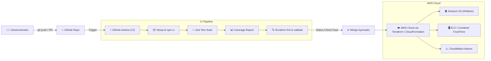

# FoodTime DevOps Project 🚀

> **Disciplina:** DevOps na Prática (10º Trimestre - PUC Graduação)  
> **Fase 1:** Configuração e Automação Inicial  
> **Estudante:** Patrick  

Este repositório contém a implementação prática da **Fase 1 do Projeto de DevOps**, cobrindo o planejamento técnico, configuração do controle de versão no GitHub, implementação de esteira de Integração Contínua (CI) com GitHub Actions, desenvolvimento de suíte de testes automatizados e provisionamento de Infraestrutura como Código (IaC) com Terraform e AWS CloudFormation.

---

## 📋 Sumário
1. [Visão Geral do Projeto e Objetivos](#-visão-geral-do-projeto-e-objetivos)
2. [Requisitos do Sistema](#-requisitos-do-sistema)
3. [Arquitetura e Fluxo DevOps](#-arquitetura-e-fluxo-devops)
4. [Estrutura do Repositório](#-estrutura-do-repositório)
5. [Como Executar Localmente](#-como-executar-localmente)
6. [Testes Automatizados](#-testes-automatizados)
7. [Pipeline de Integração Contínua (CI)](#-pipeline-de-integração-contínua-ci)
8. [Infraestrutura como Código (IaC)](#-infraestrutura-como-código-iac)
   - [Provisionamento com Terraform](#provisionamento-com-terraform)
   - [Provisionamento com AWS CloudFormation](#provisionamento-com-aws-cloudformation)
9. [Observabilidade e Métricas](#-observabilidade-e-métricas)

---

## 🎯 Visão Geral do Projeto e Objetivos

O **FoodTime** é uma aplicação backend e web para ecossistemas de pedidos e delivery rápido. O propósito deste projeto na disciplina é aplicar em um cenário real as práticas e valores de DevOps:

- **Automação de Qualidade:** Garantir que todo código submetido seja verificado imediatamente através de testes unitários e de integração antes de qualquer mesclagem.
- **Fail Fast e Feedback Contínuo:** Detectar erros de sintaxe, falhas lógicas e regressões nos primeiros minutos após o push ou criação de Pull Request.
- **Infraestrutura Reprodutível e Idempotente:** Eliminar configurações manuais (*clickOps*) usando IaC para criar ambientes idênticos sob demanda.
- **Observabilidade Nativas:** Expor métricas operacionais para Prometheus e CloudWatch desde a primeira fase de desenvolvimento.

---

## ⚙️ Requisitos do Sistema

### Requisitos Funcionais (Aplicação FoodTime)
- **RF01 - Health Check:** Fornecer endpoints (`/` e `/health`) para checagem rápida de disponibilidade do serviço.
- **RF02 - Catálogo / Pedidos:** Expor rotas de API REST para consulta de pedidos (`/api/orders`).
- **RF03 - Interface Web:** Renderizar visões em HTML/EJS com páginas informativas (`/index` e `/about`).
- **RF04 - Coleta de Métricas:** Expor métricas de consumo de recursos e requisições HTTP no endpoint padronizado `/metrics`.

### Requisitos Não Funcionais e DevOps
- **RNF01 - Versionamento:** Código-fonte versionado em repositório GitHub com política de branches protegidas.
- **RNF02 - Automação de CI:** Execução automática da suíte de testes a cada push e PR com geração de relatórios de cobertura.
- **RNF03 - IaC Declarativo:** Provisionamento de bucket S3 com criptografia AES256, Security Groups e instância de computação via Terraform e CloudFormation.
- **RNF04 - Monitoramento de Infraestrutura:** Alarme do Amazon CloudWatch para monitorar consumo de CPU (>80%).

---

## 🏗 Arquitetura e Fluxo DevOps



---

## 📁 Estrutura do Repositório

```text
foodtime-devops/
├── .github/
│   └── workflows/
│       └── ci.yml             # Pipeline de CI com GitHub Actions
├── controller/
│   └── controller.js          # Controladores e rotas REST da API
├── infra/
│   ├── cloudformation/
│   │   └── template.yaml      # Stack CloudFormation completa
│   └── terraform/
│       ├── main.tf            # Recursos AWS (S3, SG, EC2, CloudWatch)
│       ├── outputs.tf         # Saídas geradas (IP, URLs, Bucket ID)
│       ├── terraform.tfvars.example # Exemplo de variáveis de entrada
│       ├── variables.tf       # Declaração das variáveis configuráveis
│       └── versions.tf        # Restrições de versão do Terraform e provedores
├── test/
│   └── app.test.js            # Suíte completa de testes automatizados (Jest + Supertest)
├── views/
│   ├── layouts/
│   │   ├── footer.ejs         # Rodapé das visões
│   │   ├── head.ejs           # Cabeçalho HTML e estilos CSS Bootstrap
│   │   └── header.ejs         # Barra de navegação responsiva
│   └── pages/
│       ├── about.ejs          # Página sobre o projeto
│       └── index.ejs          # Página inicial da aplicação
├── .gitignore                 # Arquivos ignorados pelo Git
├── Dockerfile                 # Empacotamento em contêiner Docker (Node 20 Alpine)
├── package.json               # Configurações do projeto e dependências
├── README.md                  # Documentação completa
└── server.js                  # Ponto de entrada da aplicação Express e Prometheus
```

---

## 💻 Como Executar Localmente

### Pré-requisitos
- [Node.js](https://nodejs.org/) v20+ ou v22+
- [Git](https://git-scm.com/)

### Passos de Instalação e Execução
```bash
# 1. Clonar o repositório
git clone https://github.com/luzpatrick/foodtime-devops.git
cd foodtime-devops

# 2. Instalar dependências
npm install

# 3. Iniciar o servidor de desenvolvimento
npm start
```
Acesse a aplicação no navegador em: `http://localhost:3000/index`.

---

## 🧪 Testes Automatizados

A aplicação conta com suíte automatizada usando **Jest** e **Supertest**, validando status HTTP, formato de retorno JSON, renderização de templates EJS e contadores de observabilidade.

Para rodar todos os testes:
```bash
npm test
```

Para rodar com relatório de cobertura de código (*Code Coverage*):
```bash
npm run test:coverage
```

### Resultados Obtidos:
- **11 testes executados e aprovados** (100% de sucesso).
- **Cobertura superior a 94%** do código-fonte.

---

## ⚡ Pipeline de Integração Contínua (CI)

O pipeline está configurado no arquivo [`.github/workflows/ci.yml`](.github/workflows/ci.yml) e é acionado a cada `push` ou `pull_request` nos branches `main` e `develop`.

### Etapas do Pipeline:
1. **Checkout do Código:** Faz o clone do repositório no runner Linux (`ubuntu-latest`).
2. **Setup do Node.js:** Prepara o runtime Node.js v20 com cache automático de dependências do npm.
3. **Instalação Limpa (`npm ci`):** Garante ambiente determinístico baseado no `package.json`.
4. **Execução dos Testes Automatizados:** Executa `npm run test:coverage` gerando métricas de cobertura.
5. **Publicação de Artefatos:** Envia a pasta de cobertura `coverage/` como artefato para análise e auditoria.
6. **Validação Estática de IaC:** Instala o Terraform CLI e executa checagens de sintaxe e padronização (`terraform fmt -check`, `terraform init` e `terraform validate`).

---

## ☁️ Infraestrutura como Código (IaC)

### Provisionamento com Terraform

Os scripts estão localizados no diretório [`infra/terraform/`](infra/terraform/).

#### Recursos Provisionados:
- **Amazon S3:** Bucket com prefixo dinâmico (`foodtime-dev-`), versionamento habilitado, criptografia AES256 do lado do servidor (SSE-S3) e bloqueio integral de acesso público.
- **AWS Security Group:** Regras de entrada para tráfego web HTTP (80), aplicação FoodTime (3000) e acesso seguro SSH (22).
- **Amazon EC2:** Instância com Amazon Linux 2023 executando a aplicação FoodTime via User Data script.
- **Amazon CloudWatch:** Alarme para monitoramento de uso elevado de CPU (>80% por 2 períodos consecutivos de 5 minutos).

#### Comandos para Execução:
```bash
cd infra/terraform

# Inicializar provedores e plugins do Terraform
terraform init

# Validar sintaxe
terraform validate

# Planejar as alterações
terraform plan

# Aplicar o provisionamento na nuvem AWS
terraform apply -auto-approve
```

---

### Provisionamento com AWS CloudFormation

Como alternativa e complemento nativo da AWS (abordado na Aula 5), foi implementado o template [`infra/cloudformation/template.yaml`](infra/cloudformation/template.yaml).

#### Comandos para Execução via AWS CLI:
```bash
# Validar o template CloudFormation
aws cloudformation validate-template --template-body file://infra/cloudformation/template.yaml

# Criar a stack de recursos
aws cloudformation create-stack \
  --stack-name foodtime-devops-stack \
  --template-body file://infra/cloudformation/template.yaml \
  --parameters ParameterKey=Environment,ParameterValue=dev
```

---

## 📊 Observabilidade e Métricas

A aplicação exporta métricas nativas compatíveis com Prometheus na rota `/metrics`:
- `http_requests_total`: Contador categorizado por método HTTP (`GET`, `POST`), rota e status code.
- `http_request_duration_seconds`: Histograma de latência das requisições em segundos.
- Métricas de sistema operacional: Consumo de memória da heap, CPU do processo e loop de eventos Node.js.

---

## 👤 Autor
- **Estudante:** Patrick
- **E-mail:** luzpatrick@gmail.com
- **Instituição:** Pontifícia Universidade Católica (PUC) - Disciplina de DevOps na Prática
